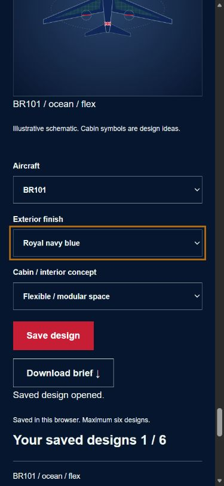

# Raj Solara

An interactive fictional solar-assisted aircraft concept studio, now featuring the user’s BR101 platform. Project owner: **Rajakokila-P**.

Live site: https://rajakokila-p.github.io/raj-solara/

## Visuals




More screenshots and the browser checks behind them are in [browser evidence](docs/browser-evidence.md).

## Run locally

On Windows, extract the archive and open `raj-solara/start-windows.bat`. Alternatively, with Node.js installed, open a terminal in the `raj-solara` folder and run:

```powershell
node scripts/serve.cjs
```

Open http://127.0.0.1:4177. Keep the terminal running. If Node is not on your Windows PATH:

```powershell
& "C:\Program Files\nodejs\node.exe" scripts/serve.cjs
```

Running the website needs no npm install, paid API, account or backend. Running the tests and lint needs `npm install` once (see Testing).

## Purpose and audience

Aviation enthusiasts and students can explore fictional aircraft, compare design assumptions and see why sunlight alone does not establish an aircraft's feasibility. No operational aircraft, flight-control system or certified performance is represented.

## Usage

1. Open the studio and use the search box or mission filter to find an aircraft.
2. Select up to three concepts to compare them. Filtering keeps your selections.
3. Change the energy assumptions to see how endurance is calculated.
4. Choose an aircraft, exterior finish and cabin concept, then download the brief.
5. Save up to six configurations in your browser. Reopen or delete them from the saved list.
6. Open the systems section to read about solar, storage, autonomy, curved wings, satellite communication and sensing.

Saved designs are stored only in your browser. Clearing site data removes them.

## User stories

1. Find an aircraft by name or mission, with clear empty results.
2. Compare up to three concepts without losing selections when filtering.
3. Change energy assumptions and understand the resulting calculation.
4. Configure aircraft, exterior finish and interior, then download a brief.
5. Save, reopen and delete up to six configurations, with a storage fallback.
6. Explore six systems: solar, storage, autonomy, curved wings, satellite communication and optical/thermal sensing.
7. Use the interface by keyboard and on a small screen.
8. Receive clear invalid-input feedback and recover from a missing URL.

## Implementation

`dist/` contains the website. HTML structure, CSS presentation and JavaScript behaviour are separate. `model.js` holds pure filtering, validation and energy functions. `app.js` manages DOM events and state. `art.js` generates a controlled SVG schematic, with only allowlisted colours and fixed geometry. Arbitrary text uses textContent. The enquiry never submits data.

Native anchors preserve browser history. LocalStorage is synchronous; storage events from another tab arrive asynchronously. Concurrent edits use last-writer-wins, not atomic collaboration. Downloads revoke object URLs after a delay. The cancellable missing-page timer is approximate because browser scheduling can delay it.

## Energy assumptions

All aircraft figures are fictional educational inputs. Solar power uses 1 kW/m² reference irradiance and 22% assumed efficiency. Available energy retains 20% of starting battery energy. Endurance assumes a constant electrical load minus constant solar input. It omits aircraft mass, drag, take-off, thermal effects, battery degradation, weather variation and conversion losses. It is not a flight-planning tool.

## Testing

Run `npm install` once, then `npm test` or `node --test tests/*.test.js`. See [testing](docs/testing.md) for verified results and outstanding manual checks. Automated checks are not a claim of full accessibility or distinction.

## Deployment

Publish the **contents of dist** at the root of a static host. Configure missing pages to use 404.html. For GitHub Pages, the source is GitHub Actions and the "Publish Raj Solara" workflow publishes the contents of dist; the repository root has no index.html. For a project URL such as /raj-solara/, update all four root-relative paths in 404.html and HOME in js/recovery.js to that exact base path. Test a nested missing URL, cancellation and timed recovery after publishing. Record the actual live URL, deployed commit/date and local/live equivalence in docs/testing.md.

## Git and ownership

The repository owner makes the commits. The history is visible with `git log`. Commits are made under the owner's own GitHub identity. The Contributors display is controlled by GitHub's attribution of actual commits, not this README.

## Contributing

This is a closed coursework project, so contributions are not being accepted. Bug reports and suggestions are welcome as GitHub issues.

## Support

For questions or problems, open an issue at https://github.com/Rajakokila-P/raj-solara/issues. Include the browser, the device width and the steps to reproduce the problem.

## Roadmap

- Complete the manual browser checks listed in [testing](docs/testing.md).
- Resolve the licence status of the third-party images listed under Licence.
- Reduce the remaining CSS validator warnings in batches, with a browser check after each batch.
- Collect real user feedback and add it to the testing record.

## Authors and acknowledgment

- Concept direction and supplied BR101 presentation and pictures: Rajakokila-P.
- Project concept and direction: Rajakokila-P. Implementation, documentation and test development received AI assistance. Final Windows regression tests were executed by Rajakokila-P.
- The BR101 cover image and supplied pictures are the owner's supplied material. Their licence status is still being confirmed (see Licence).

## Licence

The code, HTML, CSS, JavaScript, tests and original written documentation in this repository are licensed under the MIT Licence. See [LICENSE](LICENSE).

The MIT Licence does not apply to third-party or supplied material. This includes the supplied BR101 presentation and the cover image `dist/assets/br101-design-reference.png`, which retains its embedded Gemini Notebook mark, and the supplied pictures `dist/assets/br101-vision.png`, `dist/assets/br202-silver.png`, `dist/assets/br202-cobalt.png` and `dist/assets/br303-pearl.png`. Their rights remain with their owners. Their licence status is still being confirmed. The generated aircraft render at `dist/assets/solara-british-aircraft.png` is not covered by the MIT Licence until its terms are confirmed.

## Project status

Working starting implementation, not a guaranteed grade. All pass and merit criteria must be met before distinction can be considered. HTML validation, CSS validation, JavaScript lint and automated browser regression testing have been completed. CSS warnings, full accessibility review, real user feedback, personal reflection and final deployment verification remain outstanding. See docs/design.md and docs/testing.md.

## British aircraft imagery revision

A modern fictional aircraft render now replaces the hero and collection schematics. It uses navy blue, white and red with a Union Jack tail. All cards share this concept image; it does not represent three independently engineered aircraft. The studio retains an interactive schematic so finish and interior changes remain visible. Navy and red replace the previous blue/copper finish colours. Existing stored finish keys are retained for compatibility.

Image: dist/assets/solara-british-aircraft.png, generated using the built-in OpenAI image tool. Prompt: premium photorealistic fictional solar-assisted autonomous aircraft above clouds, swept solar-panel wings, royal navy blue, pearl white and red livery, Union Jack tail, no airline logo or performance claims. The flag is a design motif, not an assertion of government or airline affiliation.

## BR101 integration  5 November 2026

The supplied **Platform_BR101.pptx** is the concept source. BR101 is the flagship research design; Aurora, Stratos and Courier remain alternative studies. Compare up to three of the four designs. Existing saved-design keys remain compatible.

Your ideas now appear as six selectable system topics, a four-stage operations loop, the original cover reference, a 24-hour battery-budget calculator and a delayed mission-update demonstration. See [source mapping](docs/br101-source-map.md) for slide-by-slide traceability and distinctions between ambition and evidence.

BR101's 160 kWh capacity, 90 m² panel area and 30 kW default demand are **new invented teaching inputs**, not figures taken from your deck. All aircraft performance remains unverified. The daily calculator is a separate illustration with independently selected peak solar and demand. It uses a 160 kWh battery, fixed 32 kWh reserve, sinusoidal 06:00–18:00 solar input sampled at hourly midpoints, 90% charging efficiency and no discharge loss. At reserve the illustrative mission stops and energy is frozen. This does not simulate a real flight, landing or night-time operation.

### Asynchronous behaviour

`systems.js` snapshots the selected scenario before starting a 1.2-second timer. It displays an indeterminate progress indicator and prevents duplicate requests. Changing scenario or cancelling clears the timer and increments a request version. The completion callback checks its version before updating shared DOM state, so an obsolete response cannot overwrite a newer selection. The offline scenario reports failure and enables retry. This is a local timing demonstration, not an API or satellite connection.

### Evidence and credits

HTML, CSS and JavaScript

Duckett, J. (2011) HTML and CSS: Design and Build Websites. Indianapolis: Wiley.
Meyer, E. and Weyl, E. (2017) CSS: The Definitive Guide. 4th edn. Sebastopol: O’Reilly.
Haverbeke, M. (2024) Eloquent JavaScript. 4th edn. San Francisco: No Starch Press.

Responsive design and layout

Marcotte, E. (2011) Responsive Web Design. New York: A Book Apart.

Usability and visual design

Krug, S. (2014) Don’t Make Me Think, Revisited: A Common Sense Approach to Web Usability. 3rd edn. Berkeley: New Riders.
Norman, D. (2013) The Design of Everyday Things. Revised and expanded edn. New York: Basic Books.
Wathan, A. and Schoger, S. (2018) Refactoring UI. Self-published.

Accessibility

Pickering, H. (2016) Inclusive Design Patterns. Freiburg: Smashing Media.
Kalbag, L. (2017) Accessibility for Everyone. New York: A Book Apart.

Testing

da Costa, L. (2021) Testing JavaScript Applications. Shelter Island: Manning.

Referencing

Pears, R. and Shields, G. (2022) Cite Them Right: The Essential Referencing Guide. 12th edn. London: Bloomsbury. This is the standard UK Harvard guide, and it also covers how to reference AI tools, which fits your project declaration.

## Supplied aircraft pictures  5 November 2026

The Pictures navigation link opens a responsive four-image gallery: the BR101 vision board, silver/cobalt BR202, deep-cobalt BR202 and pearl/slate BR303. Original image pixels are preserved. Each image has descriptive alternative text, a caption and a full-size link explicitly labelled as opening a new tab. The images are bundled locally and lazy-loaded. The BR101 caption qualifies the artwork's infinite-endurance statement as unverified.

Source: four images supplied by Rajakokila-P in this conversation. New filenames: `br101-vision.png`, `br202-silver.png`, `br202-cobalt.png`, `br303-pearl.png` in `dist/assets`. The existing interactive catalogue is unchanged; these livery studies are not assigned invented performance specifications. The attached MP4 is not included in this pictures-only update.

## Raj Solara branding and browser evidence

The public name is now **Raj Solara**, including titles, navigation branding, footer, About, missing-page recovery, server message and downloaded brief. The internal storage key is retained for compatibility. See [browser evidence](docs/browser-evidence.md) for the executed Edge checks and screenshots. The renamed package passed nine automated browser regression checks on 14 November 2026.

Extract this archive into a new directory. Open the `raj-solara` folder in VS Code. Stop the old local server with Ctrl+C before starting this copy, or change both port references in scripts/serve.cjs if that port is occupied. Do not overwrite your personal changes without comparing them first.

## British colour brand symbol

A decorative three-line red, white and navy mark appears beside Raj Solara in the header and footer, inspired by the user-supplied British-flag light-trail reference. The white line has an outline for visibility. This is a colour motif, not a literal Union Jack. It uses inline SVG, requires no image download and is hidden from assistive technology because the adjacent name supplies the link text.

## Code validation 5 November 2026

See [validation results and remaining warnings](docs/validation.md) for official HTML/CSS reports, ESLint configuration and reproducible commands. These results apply to the corrected local source; live deployment must be updated and rechecked.


## Latest testing results  14 November 2026

| Verification | Result |
| --- | --- |
| Node.js unit tests | 13/13 passed |
| Playwright browser tests | 9/9 passed |
| Browser page errors | 0 |
| ESLint | 0 errors, 0 warnings |
| HTML validation | Three pages passed |
| CSS validation | 0 errors, 101 warnings |
| Dependency audit | 0 known vulnerabilities |

### Testing evidence

- [Complete testing record](docs/testing.md)
- [Evidence index](docs/evidence-index.csv)
- [Browser test results](docs/evidence/validation/windows-browser-tests.txt)
- [Desktop screenshots](docs/evidence/desktop/)
- [Responsive screenshots](docs/evidence/responsive/)
- [Accessibility evidence](docs/evidence/accessibility/)
- [Design storage evidence](docs/evidence/design-storage/)

The 22 successful automated checks demonstrate the tested functionality. Full accessibility compliance, target-user feedback and final deployment verification remain outstanding.
