# Raj Solara — Interactive Front End Development

**Project owner:** Rajakokila-P  
**Qualification:** Level 5 Diploma in Web Application Development — Unit 2: Interactive Front End Development  
**Project type:** Original fictional solar-assisted aircraft concept exploration website  
**Live website (verify against the latest deployment):** [Raj Solara on GitHub Pages](https://rajakokila-p.github.io/raj-solara/)  
**Source:** [GitHub repository](https://github.com/Rajakokila-P/raj-solara)

> **Important:** Aircraft specifications, energy simulations and mission communications are illustrative educational concepts, not certified engineering data or live satellite connections. This README documents the evidence included in the submitted project ZIP. Items marked *pending* have not been evidenced as completed; the deployed site must be checked separately.

## Table of Contents

1. [UX](#1-ux)
   - [1.1 Project Purpose](#11-project-purpose)
   - [1.2 Audience](#12-audience)
   - [1.3 User Stories](#13-user-stories)
   - [1.4 Wireframes and Design](#14-wireframes-and-design)
2. [Features](#2-features)
   - [2.1 Existing Features](#21-existing-features)
   - [2.2 Features Left to Implement](#22-features-left-to-implement)
3. [Technologies Used](#3-technologies-used)
   - [3.1 Core Web Technologies](#31-core-web-technologies)
   - [3.2 Libraries & External Resources](#32-libraries--external-resources)
   - [3.3 Design & Prototyping Tools](#33-design--prototyping-tools)
   - [3.4 Branding & Asset Creation Tools](#34-branding--asset-creation-tools)
   - [3.5 Image Preparation & Optimisation](#35-image-preparation--optimisation)
   - [3.6 Accessibility Tools](#36-accessibility-tools)
   - [3.7 Testing & Debugging Tools](#37-testing--debugging-tools)
   - [3.8 Deployment](#38-deployment)
   - [3.9 Project Management & Version Control](#39-project-management--version-control)
4. [Testing](#4-testing)
   - [4.1 Manual Testing](#41-manual-testing)
   - [4.2 User Story Acceptance Testing](#42-user-story-acceptance-testing)
   - [4.3 Validators](#43-validators)
5. [Deployment](#5-deployment)
   - [5.1 How to Run This Project Locally](#51-how-to-run-this-project-locally)
   - [5.2 Deployment with GitHub Pages](#52-deployment-with-github-pages)
6. [Credits](#6-credits)
   - [6.1 Contents](#61-contents)
   - [6.2 Media](#62-media)
   - [6.3 Code](#63-code)
   - [6.4 Acknowledgements](#64-acknowledgements)

---

## 1. UX

### 1.1 Project Purpose

Raj Solara is a responsive, interactive educational concept studio. Visitors can explore speculative aircraft, search and compare designs, adjust an energy-budget model and save personalised studio configurations in their browser. Its purpose is to make design trade-offs understandable without falsely suggesting these aircraft have been built, flight-tested or certified.

The site combines a visually organised catalogue with genuine front-end interactions and clear limitations on speculative performance figures. The [BR101 source mapping](docs/br101-source-map.md) distinguishes supplied ideas from invented teaching inputs.

### 1.2 Audience

The intended audience is aviation enthusiasts, students and visitors interested in renewable energy, aircraft concepts and interactive technology demonstrations. They need clear navigation, plain-language explanations, an accessible display of assumptions and feedback when they make selections or enter invalid values. **Actual target-user interviews or acceptance feedback are not documented as completed** in this archive.

### 1.3 User Stories

| ID | As a visitor, I want to… | Evidence / feature |
| --- | --- | --- |
| US01 | Find concepts using search and mission filters | Catalogue and reset controls; browser regression check |
| US02 | Compare up to three concepts | Comparison controls and limit feedback |
| US03 | Change energy inputs and see calculated outputs | Energy lab and associated unit tests |
| US04 | Choose an aircraft and its finish/interior, then download a brief | Interactive studio and download screenshots |
| US05 | Save, reopen and delete configurations locally | Saved-design screenshots and browser regression |
| US06 | Explore the proposed aircraft systems | Six selectable system topics |
| US07 | Use the website on mobile and with keyboard input | Responsive images and sampled focus evidence; full audit pending |
| US08 | Receive useful feedback for invalid inputs and missing URLs | Form-validation and 404/recovery evidence |

### 1.4 Wireframes and Design

The implemented layout uses a clear page hierarchy: header/navigation → introductory hero → aircraft catalogue → comparison/energy experiences → systems information → design studio → enquiry/footer. On narrow screens, cards and panels stack vertically; comparison data remains inside a contained scrolling region.

**Design rationale:** navy conveys sky and technology, white provides readable content areas, and red draws attention to actions. Native HTML controls, labelled inputs, visible focus styling and reduced-motion styles support accessible interaction, although complete accessibility verification remains pending. See [design rationale](docs/design.md).

### Reconstructed layout wireframes (current implementation)

The two diagrams below are **present-day reconstructions of the implemented layout**, prepared on 17 November 2026 to explain information hierarchy and responsive layout. They are **not evidence of pre-development wireframes**. Original dated sketches, if available, should be added separately with their creation dates and design decisions.

**Desktop layout reconstruction**

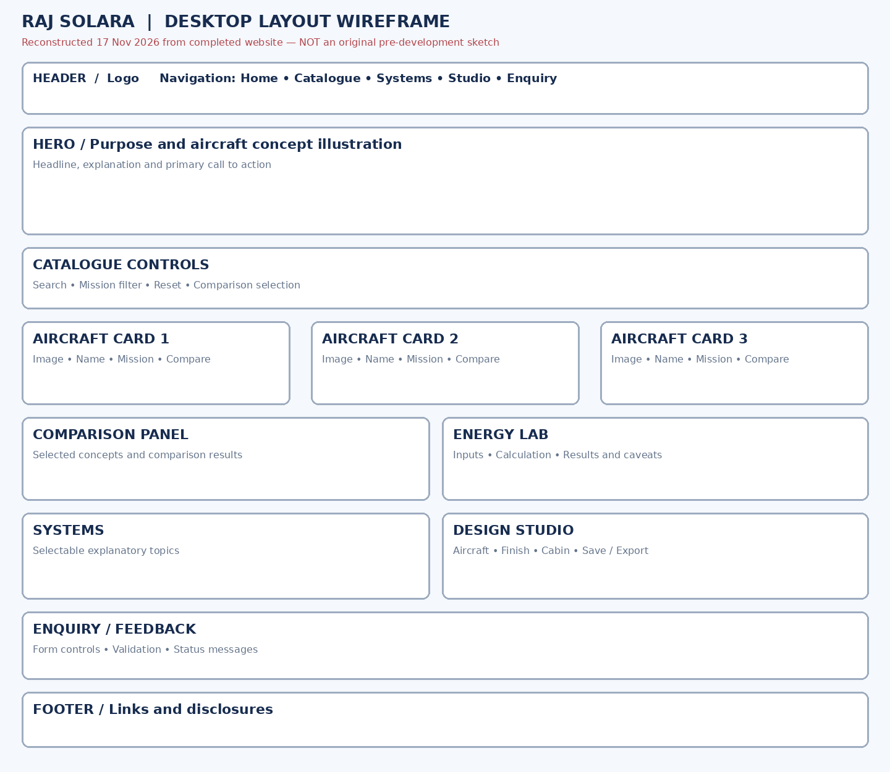

**Mobile layout reconstruction**

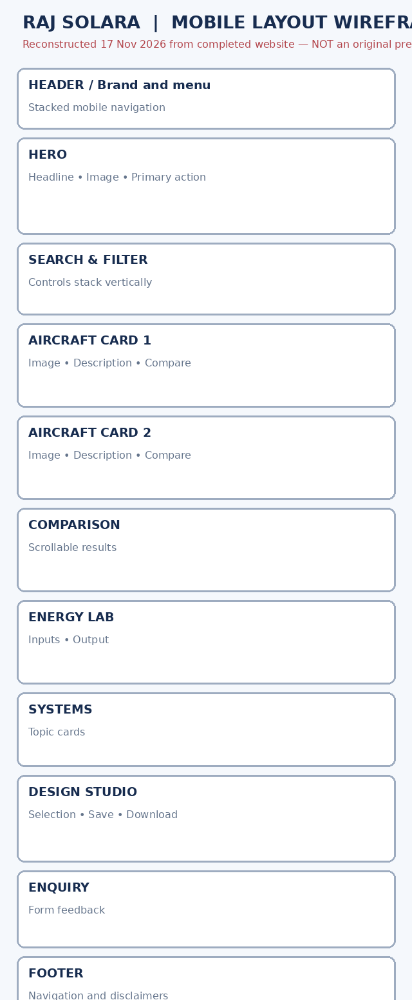

**Comparison with the finished website:** The following implementation images demonstrate the desktop and mobile layouts corresponding to the reconstructed diagrams.

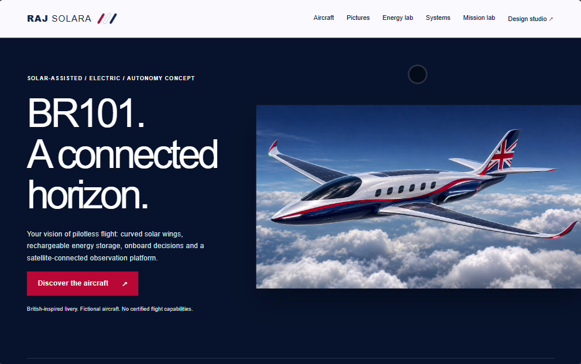

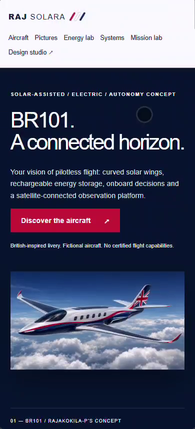

**Evidence limitation:** the following screenshots are *finished implementation screenshots*, **not** original pre-development wireframes. No independently dated pre-development wireframes have been supplied. Add real, dated sketches and explain how they informed decisions; do not relabel screenshots as original wireframes.

#### Responsive design screenshots

| Desktop homepage | Tablet homepage | Mobile homepage |
| --- | --- | --- |
|  | 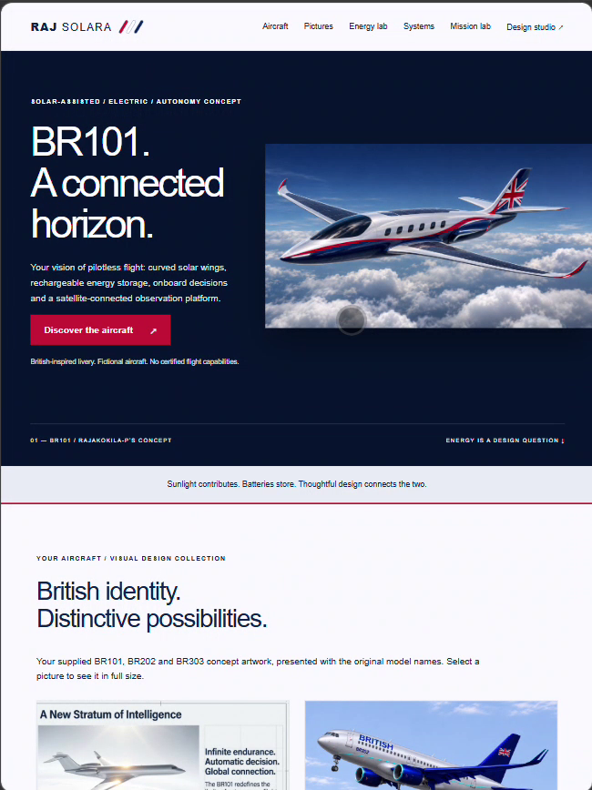 |  |

| Desktop catalogue | Tablet catalogue | Mobile catalogue |
| --- | --- | --- |
| 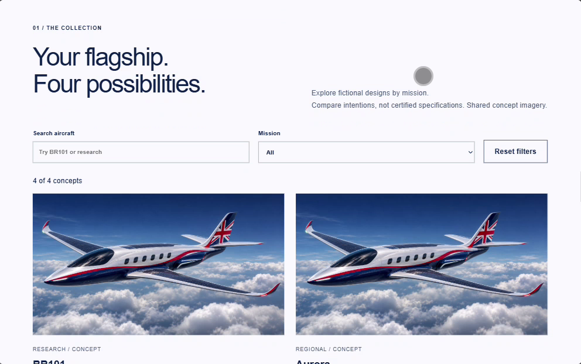 | 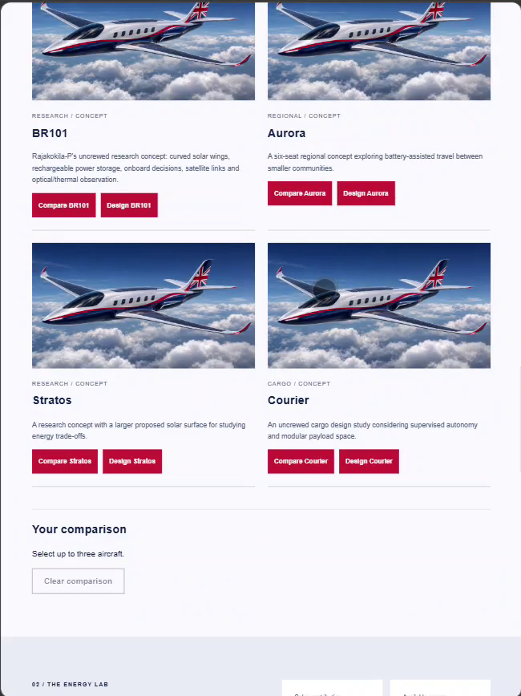 | 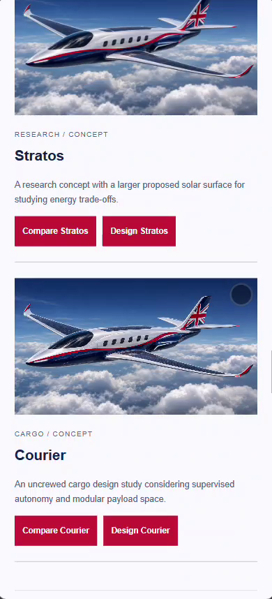 |

Recorded screenshot sizes in the supplied evidence include 992 × 622 desktop, 650 × 868 tablet and 390 × 858 mobile. These are recorded viewports, not proof of testing on separate physical devices.

---

## 2. Features

### 2.1 Existing Features

**Aircraft discovery and comparison.** Search and mission filters can narrow concept cards. Visitors may compare up to three selected concepts, with feedback on the limit and reset behaviour. The interface contains four concepts including the BR101 flagship.

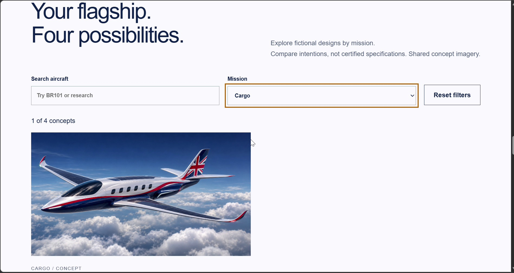

**Energy modelling.** Adjustable inputs illustrate a fictional solar-energy contribution and battery reserve. An additional hourly energy table demonstrates simplified daytime input, load and reserve. The calculations omit real aerodynamics, operating constraints, certification and many losses.

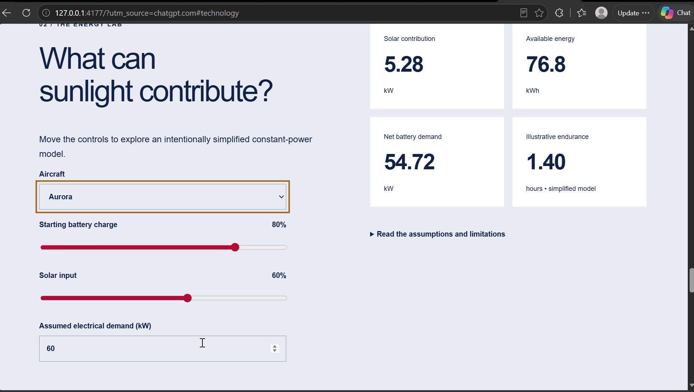

**Systems and mission demonstrations.** Six selectable system topics explain solar surfaces, energy storage, autonomy, curved wings, communications and optical/thermal sensing. A local delayed mission-update demonstration supports visible loading, cancellation, error and retry; it does *not* contact a satellite or third-party API.

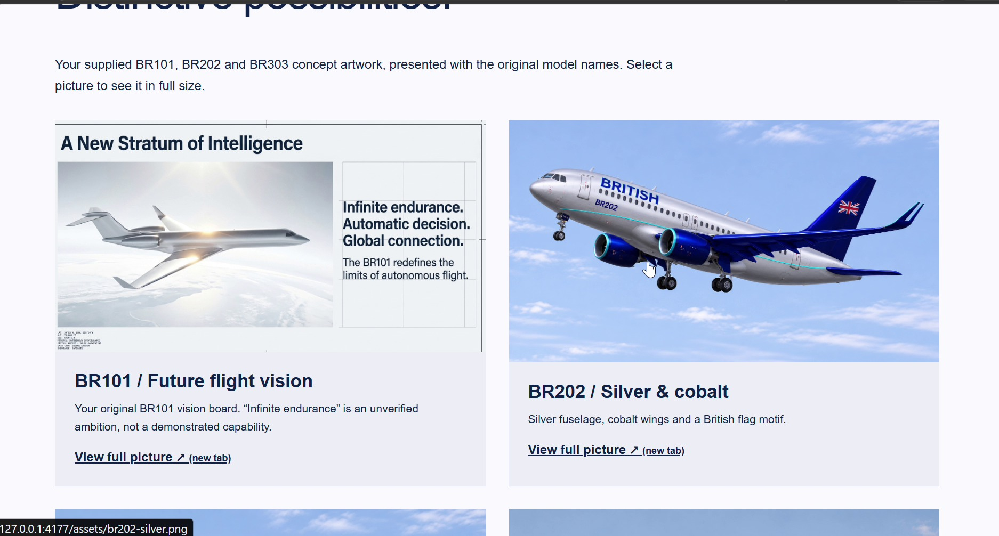

**Design studio.** Users can choose aircraft, exterior finish and cabin concept and generate a downloadable local brief.

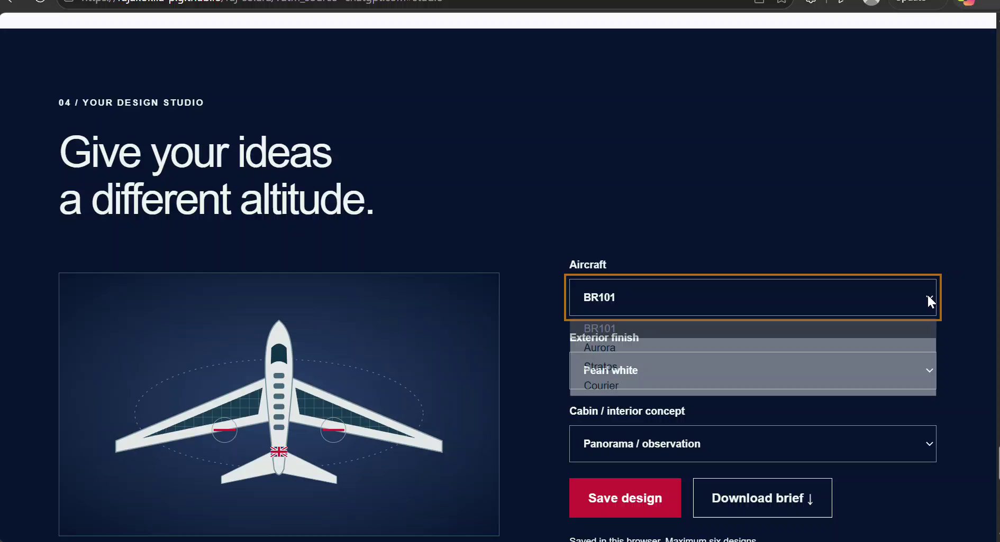

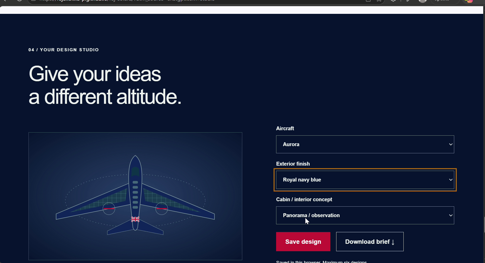

**Saved configurations.** The site stores up to six designs in browser localStorage and supports reopen and deletion. This is not a user account, cloud backup or shared database.

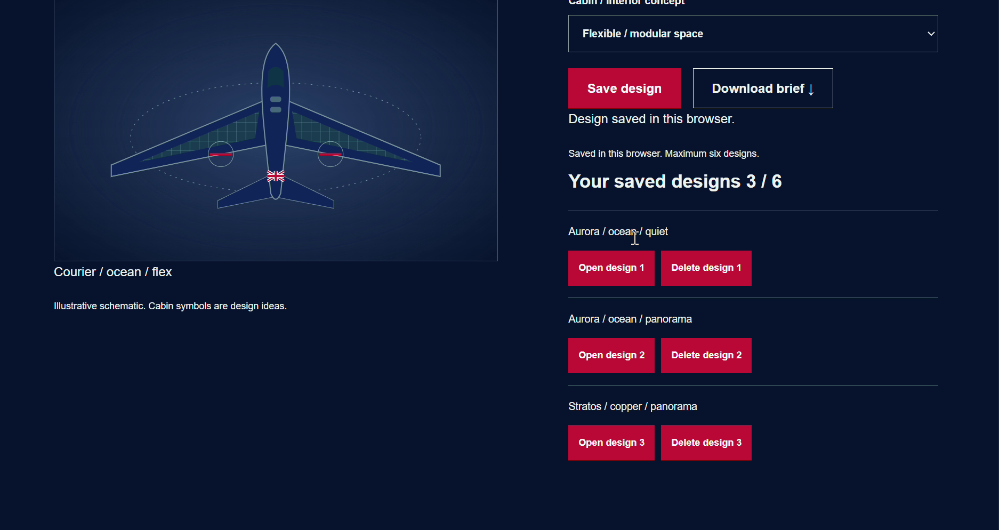

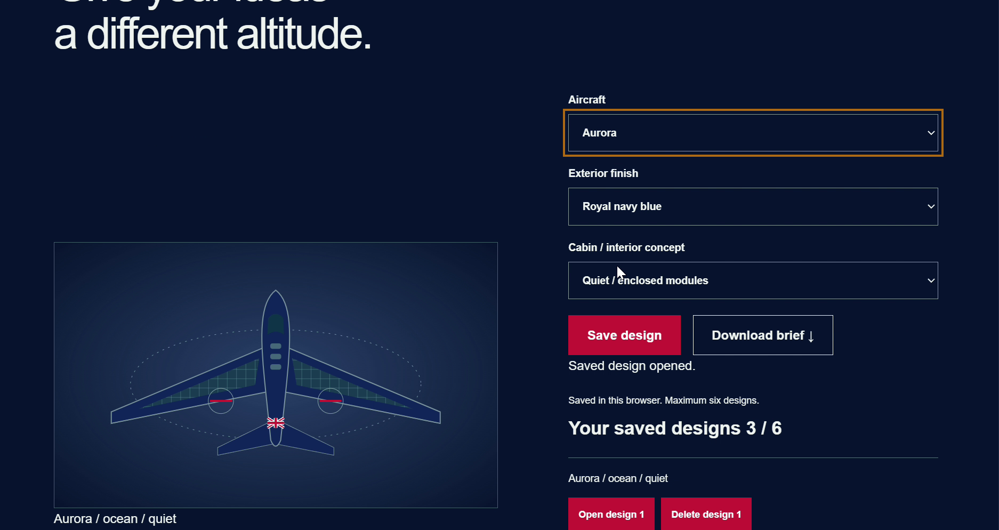

**Input validation.** The demonstration enquiry form checks required fields and input format, gives feedback and does not transmit visitor information.

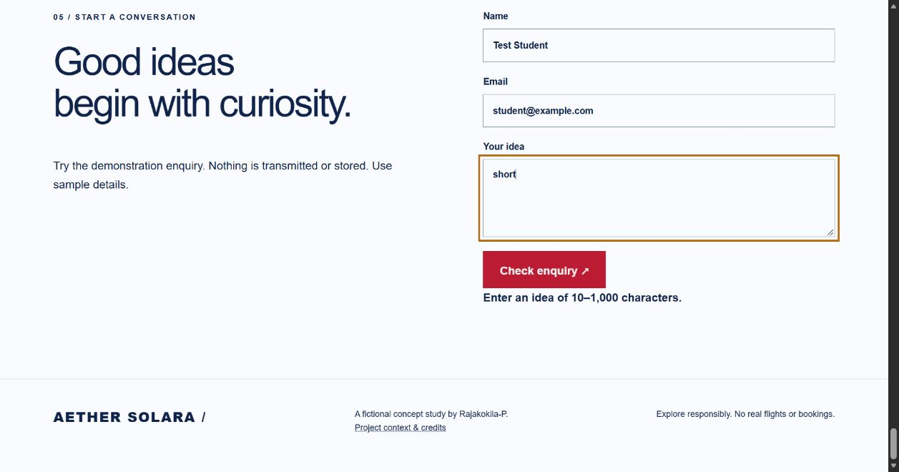

**Missing-page recovery.** A custom 404 page offers navigation home and a cancellable timed return.

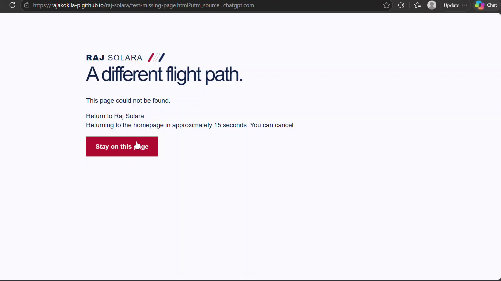

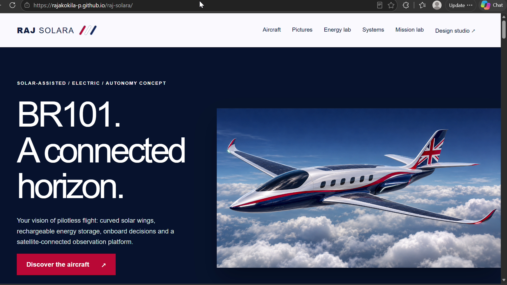

**Responsive image gallery.** Bundled BR101/BR202/BR303 visuals have alternative text and full-size links.

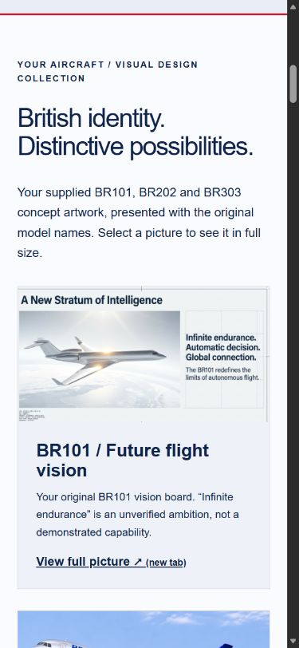

### 2.2 Features Left to Implement

These are **next steps**, not claims that the assessment currently meets them:

- Complete documented manual user journeys in multiple browsers and on appropriate devices.
- Obtain and record genuine audience feedback, usability issues and any resulting changes.
- Complete a thorough keyboard, screen-reader, contrast and zoom audit.
- Verify published GitHub Pages content matches this version and capture deployment evidence.
- Review the remaining 101 CSS validator warnings and document whether fixes are required.
- Confirm usage rights for supplied and generated images.
- Create dated, authentic design-stage wireframes and record genuine revisions where available.

---

## 3. Technologies Used

### 3.1 Core Web Technologies

- **HTML5**: semantic page structure and native interactive elements in `dist/index.html`, `dist/about.html` and `dist/404.html`.
- **CSS3**: responsive layouts, typography and component states in `dist/css/style.css`.
- **JavaScript (ES modules)**: interface behaviour, filtering, calculations, local saving and mission updates in `dist/js/`.
- **SVG**: controlled aircraft schematic generated by the project JavaScript.
- **Web Storage API**: localStorage for saved designs; no account registration or backend database.

### 3.2 Libraries & External Resources

The delivered website uses native browser APIs and does not require a paid API, backend or third-party runtime framework. Development dependencies include **ESLint** and **Playwright** (see `package.json`). The code contains educational teaching inputs; no operational aircraft telemetry or real satellite service is accessed.

### 3.3 Design & Prototyping Tools

The supplied project includes [design notes](docs/design.md) and working responsive layouts. An original pre-build design-tool file or dated prototype has **not** been provided, so no specific prototyping application is claimed here.

### 3.4 Branding & Asset Creation Tools

Raj Solara uses British-inspired navy, white and red accents. The README previously documented one concept render generated with OpenAI's image-generation tool and supplied owner-directed BR101 aircraft artwork. The decorative header mark is an inline SVG colour motif, not an official flag or airline identity.

### 3.5 Image Preparation & Optimisation

Aircraft assets are bundled under `dist/assets/`, with local image paths and descriptive alternatives. The gallery uses lazy loading where implemented. Original source files and usage rights require review; the presence of assets does not establish a transferable licence.

### 3.6 Accessibility Tools

Evidence includes sampled keyboard-focus screenshots and a WAVE accessibility-summary screenshot. These show that checks were explored, **not** that every page passed WCAG or that a full screen-reader audit occurred.

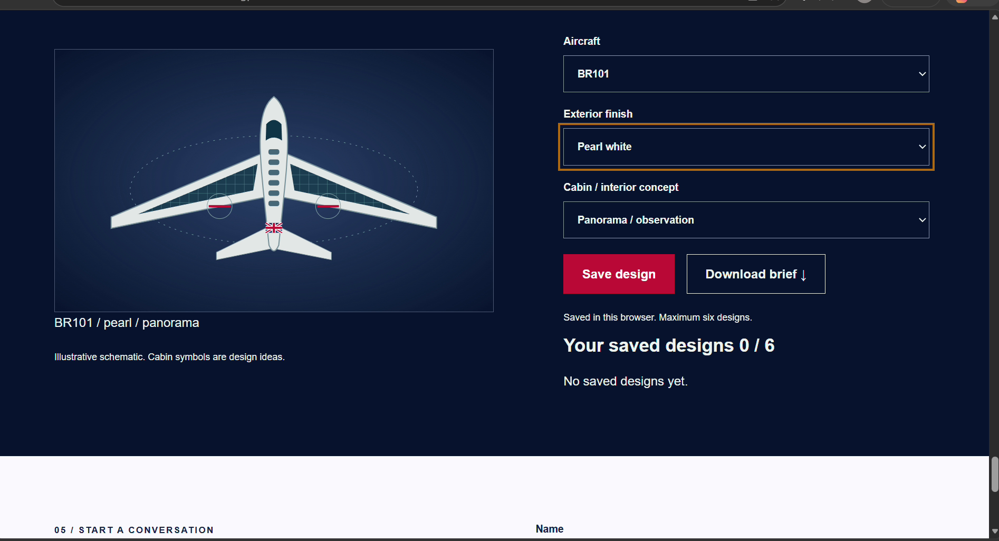

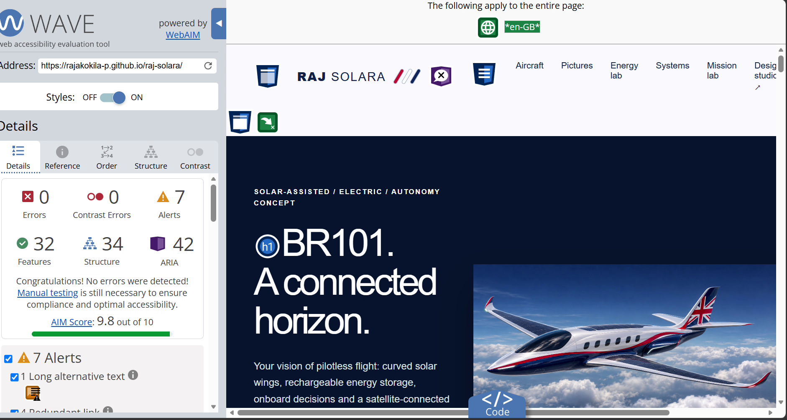

### 3.7 Testing & Debugging Tools

- Node's built-in test runner for JavaScript unit tests.
- Playwright Chromium for scripted browser regression checks.
- ESLint for JavaScript static analysis.
- W3C Nu HTML Checker and W3C Jigsaw CSS Validator for standards checks.
- Browser developer tools, captured screenshots, local server and terminal evidence.

### 3.8 Deployment

A GitHub Actions workflow at `.github/workflows/pages.yml` is configured to publish `dist/` through GitHub Pages. The latest public deployment and its precise commit remain to be checked.

### 3.9 Project Management & Version Control

Git and GitHub hold the version history. The repository [commit history](https://github.com/Rajakokila-P/raj-solara/commits) should be used to demonstrate when individual features and fixes were developed. Screenshots and test artefacts are indexed in [evidence-index.csv](docs/evidence-index.csv). **This ZIP alone does not include the repository's `.git` history**, so the exact incremental commit sequence cannot be certified from this file.

---

## 4. Testing

For a detailed distinction between executed tests and outstanding checks, refer to [docs/testing.md](docs/testing.md). The existing records report 13 successful unit tests and nine successful Playwright browser checks on 14 November 2026; this README does not claim that every manual test passed.

### 4.1 Manual Testing

| Test area | Available evidence | Status / limitation |
| --- | --- | --- |
| Layout at desktop, tablet and mobile sizes | Six responsive-view screenshots | Captured; not full cross-device certification |
| Keyboard navigation | Four focus screenshots and sampled controls | Partly evidenced; complete walkthrough pending |
| Enquiry validation | Form screenshot and recorded sampled browser actions | Partly evidenced |
| Saved configurations | Save/reopen/delete sequence screenshots | Screen evidence and browser regression available |
| Broken URL recovery | Missing-page and recovery screenshots | Evidence available; published nested URL still needs testing |
| Real target-user usability | No completed user-interview record | **Pending** |
| Cross-browser + screen reader | No completed comprehensive record | **Pending** |

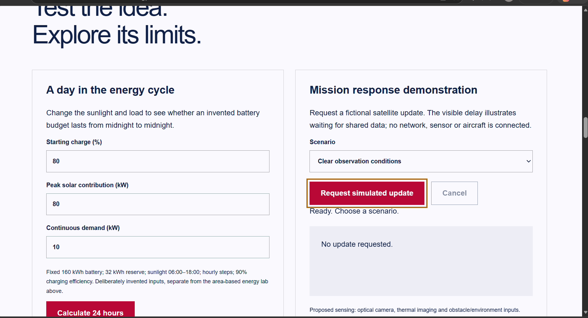

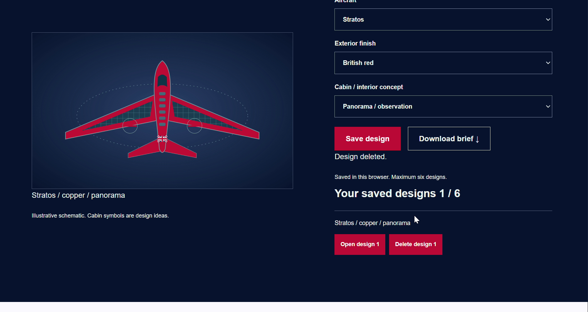

### 4.2 User Story Acceptance Testing

| User story | Automated result reported in project | Manual/user acceptance |
| --- | --- | --- |
| US01: Search/filter/reset | Pass | Formal manual record pending |
| US02: Comparison limit | Pass | Formal manual record pending |
| US03: Energy and validation | Pass | Formal manual record pending |
| US04: Configure/download brief | Studio screenshots available | Full download acceptance pending |
| US05: Save/reload/reopen/delete | Pass | Screenshots available; six-design boundary not fully verified |
| US06: Systems/mission states | Pass | Formal target-user feedback pending |
| US07: Responsive and accessible | No horizontal overflow in checked viewport sizes | Full accessibility audit pending |
| US08: Invalid enquiry and 404 | Enquiry pass; 404 screenshots available | Published-site equivalence pending |

The nine Playwright checks cover selected feature sequences and the 13 unit tests cover JavaScript functions. These **22 automated checks are not equivalent to 22 independently completed end-to-end user stories**.

**Evidence:** [browser test output](docs/evidence/validation/windows-browser-tests.txt), [unit test output](docs/evidence/validation/windows-unit-tests.txt), [full evidence index](docs/evidence-index.csv).

### 4.3 Validators

| Validation | Saved result | Supporting screenshot/report |
| --- | --- | --- |
| W3C Nu HTML Checker — index/about/404 | 0 reported errors and 0 warnings on each checked file | [Source reports](docs/evidence/validation/) |
| W3C Jigsaw CSS | Valid CSS, 0 errors, **101 warnings** | [CSS validation details](docs/validation.md) |
| ESLint | 0 errors, 0 warnings | [Saved ESLint output](docs/evidence/validation/windows-eslint.txt) |
| Node unit tests | 13 passed | [Unit test output](docs/evidence/validation/windows-unit-tests.txt) |
| Playwright browser regression | 9 passed | [Browser test output](docs/evidence/validation/windows-browser-tests.txt) |

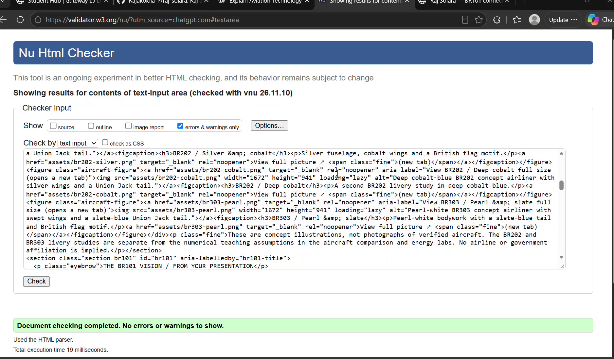

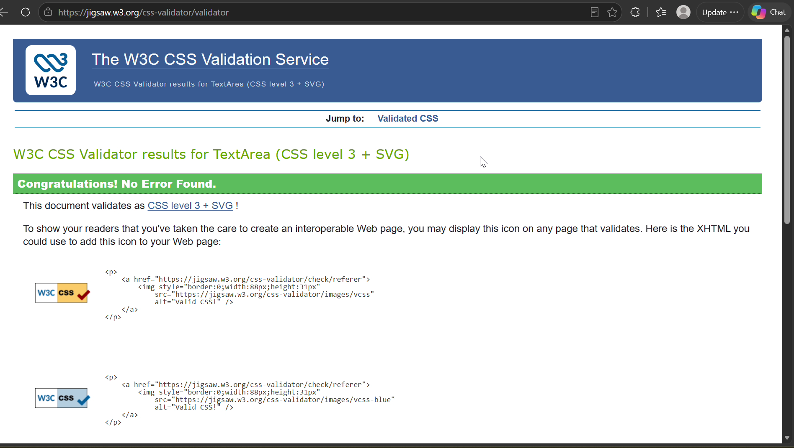

**Known limitations and changes:** a prior slider label markup defect was corrected; browser test configuration was aligned with local port 4177; a former server-connection issue was fixed. CSS warnings are retained and explained in [validation notes](docs/validation.md). Original reports need fresh comparison with the final public deployment.

---

## 5. Deployment

### 5.1 How to Run This Project Locally

1. Download and extract the repository ZIP.
2. Open the project folder containing `package.json` and `scripts/`.
3. Have Node.js installed. Start the static local server:

   ```powershell
   node scripts/serve.cjs
   ```

4. Open **http://127.0.0.1:4177** in your browser.
5. To install development/test dependencies and check the recorded code locally, run:

   ```powershell
   npm install
   npm test
   npm run lint
   ```

The website itself does not need paid services or an API key. If port 4177 is occupied, stop the other local server before launching this copy.

### 5.2 Deployment with GitHub Pages

**Existing configuration:** `.github/workflows/pages.yml` publishes the `dist/` directory, which contains the actual site files. The repository root does not contain the published index file.

1. Open the GitHub repository and go to **Settings → Pages**.
2. Under **Build and deployment**, select **GitHub Actions** as the source.
3. Ensure the `Publish Raj Solara` workflow completes successfully after the required commit is pushed.
4. Open **https://rajakokila-p.github.io/raj-solara/** and check that the visible release matches the intended commit.
5. Test the desktop/mobile pages, navigation, interactive studio, saved designs, form validation, browser console and a nested missing URL. Check the custom 404 home/cancel/timer recovery.
6. Record the **actual commit SHA, workflow run URL, deployment date, test device and results** in [docs/testing.md](docs/testing.md).

**Deployment verification status:** the project includes a workflow and published URL, but **equivalence between this ZIP and the live release has not been independently established**. The 404/recovery base paths also require checking after publication.

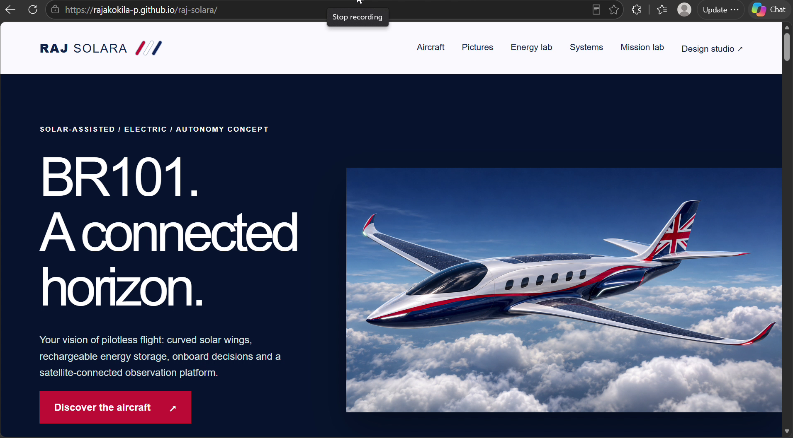

---

## 6. Credits

### 6.1 Contents

**Project concept, direction and supplied BR101 reference material:** Rajakokila-P. The explanatory aircraft content and modelling assumptions describe fictional study concepts, not operational data. Background study sources recorded in the original README include Duckett (2011), Haverbeke (2024), Krug (2014), Norman (2013), Marcotte (2011) and other programming, usability and testing texts. The earlier full reference notes are preserved in [previous README](docs/README-previous-version.md); only cite specific works that were actually consulted for the submission.

### 6.2 Media

The repository contains supplied aircraft illustrations and a generated aircraft concept render under `dist/assets/`. The previous documentation identifies `solara-british-aircraft.png` as generated using OpenAI's image tool. Supplied BR101/BR202/BR303 material may have separate ownership restrictions. **Usage rights for the supplied and generated images have not been fully confirmed.** The repository MIT licence does not automatically cover those assets.

### 6.3 Code

The repository identifies Rajakokila-P as project owner. The previous documentation states that implementation, documentation and test development received AI assistance; this disclosure is preserved here to avoid an inaccurate claim of exclusive authorship. Before submission, distinguish work you wrote and can explain from externally derived code or assistance, with attribution as required by the course. JavaScript and CSS are in separate files; test sources are in `tests/`.

**Code licence:** [MIT licence](LICENSE), subject to the third-party media exclusions described above.

### 6.4 Acknowledgements

Acknowledgement is given to educational resources, browser validation tools and project feedback used during development. The course assessor should be able to inspect the genuine Git history, original research/design evidence and the student's own understanding. Do not claim unperformed interviews, wireframes or test results.

---

### Supporting evidence and outstanding assessment work

- [Design rationale and outstanding student reflection](docs/design.md)
- [Testing record and remaining manual checks](docs/testing.md)
- [Validation details and CSS warnings](docs/validation.md)
- [Browser evidence and limitations](docs/browser-evidence.md)
- [Aircraft concept source map](docs/br101-source-map.md)
- [Screenshot evidence index](docs/evidence-index.csv)
- [Previous README retained for traceability](docs/README-previous-version.md)

**Submission note:** this README is organized to match the lecturer's Dr. Ragav example, but matching headings and inserting images alone does not demonstrate all Pass, Merit or Distinction criteria. Actual design-process evidence, target-user testing, individual contribution, Git history and published-site verification must be supplied truthfully.
