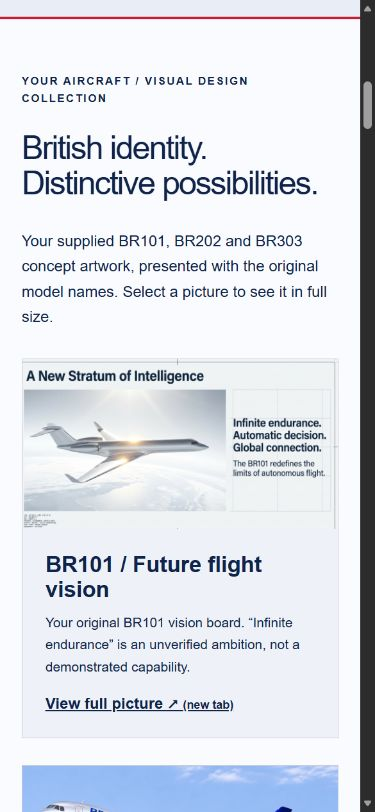
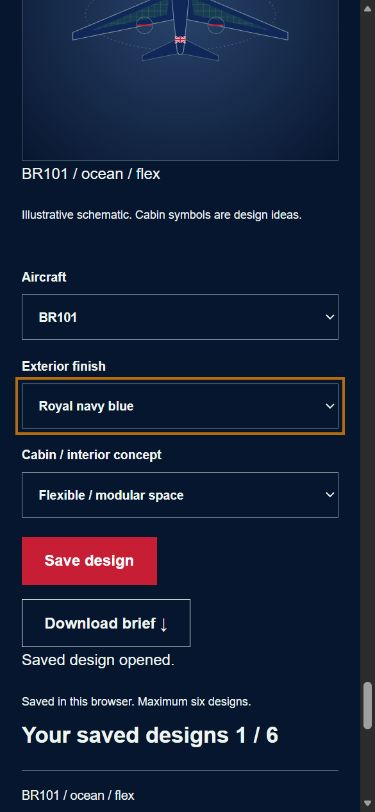
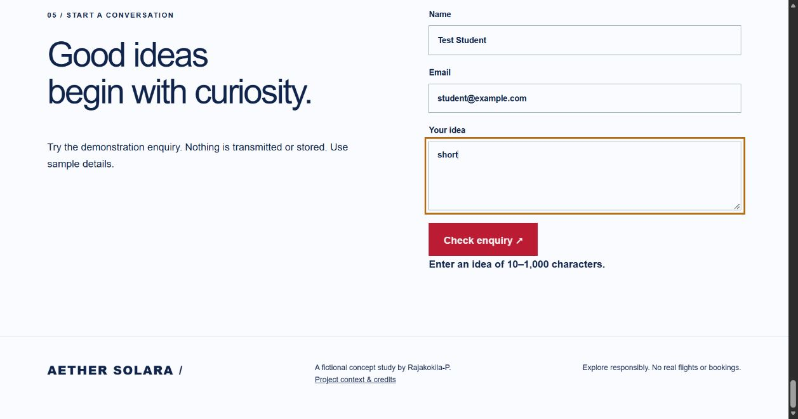

# Browser evidence — 5 November 2026

## Scope

Performed through the connected Microsoft Edge browser on the user's running site at http://127.0.0.1:4174. The tested version displayed **Aether Solara**. The packaged revision changes the brand to **Raj Solara**; it has not yet been installed and visually retested on the user's computer. This evidence is assistant-executed testing, not independent student or user research.

| Check | Actual observation | Result |
|---|---|---|
| Save and reopen | Saved BR101 / navy / flexible; reloaded page; Open design 1 restored `ocean` and `flex` selections | Pass |
| Cancel mission update | Requested update then cancelled; cancellation message remained after later form tests, with no delayed replacement | Pass |
| Empty name | Submit focused the name field and showed Enter a name | Pass |
| Invalid email | With Test Student and invalid-address, submission showed Enter a valid email address and focused email | Pass |
| Short message | With student@example.com and short, submission showed the 10–1,000 character requirement | Pass |
| Keyboard sample | Tab moved from message to submit button; solid focus outline observed; Shift+Tab returned to message; Enter reopened saved design | Pass for sampled controls only |
| 390px layout | Gallery stacked; studio finish selector usable; selected red updated summary | Pass for sampled layout |
| 320px overflow | Viewport width 320px, document width 305px; no horizontal page overflow | Pass for measured width |
| Captured console errors | No error entries returned during these checks | None observed; not proof of all paths |

One test configuration (BR101 / navy / flexible) remains saved in the browser. Test form values were cleared and the test page reloaded. Temporary viewport overrides were reset.

## Screenshots

These show the pre-rename running version and use sample data only.

## Still required

- Repeat these checks after opening the Raj Solara package.
- Complete a keyboard-only walkthrough of every control, including skip link, ranges, details, comparison and cancellation.
- Screen-reader, zoom and contrast review; real phone and additional browser testing.
- Official HTML/CSS validation and JS lint; actual target-user feedback and student reflection.
- Final public deployment and local/live equivalence checks.

This record does not award or guarantee a distinction.
